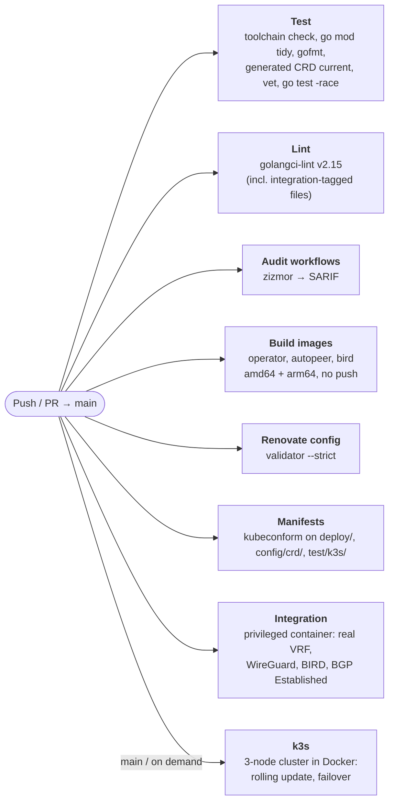
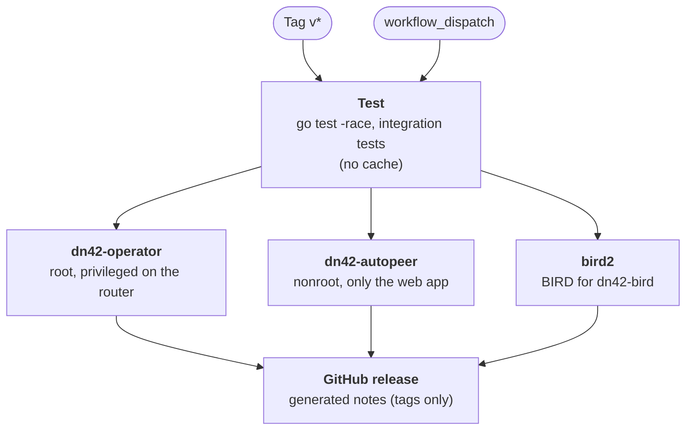

# Pipeline

Two workflows: [`ci.yaml`](workflows/ci.yaml) checks every change, and
[`release.yaml`](workflows/release.yaml) publishes. Same layout and
conventions as tlsa-dnsendpoint-controller, plus the tests that need a
Linux kernel.

## CI

Runs on every push and pull request to `main`. All jobs run in parallel and
are independent of each other. A newer push to the same ref cancels the run
in progress.

## Release

Runs on a `v*` tag, or by hand through `workflow_dispatch`. The tests run
first, without any cache, so nothing a pull request could have written ends
up in a signed image. The three images are built and signed in parallel.
The GitHub release comes last, so its page only appears once everything it
points to exists. The tag is also what the peers repo's gate installs
(`go install …/cmd/peercheck@<tag>`).

Each image is multi-arch, pushed to ghcr.io with SBOM and provenance, and
signed with cosign (keyless). A manual dispatch only publishes the moving
`:main` tags; a GitHub release is only created for a `v*` tag.
